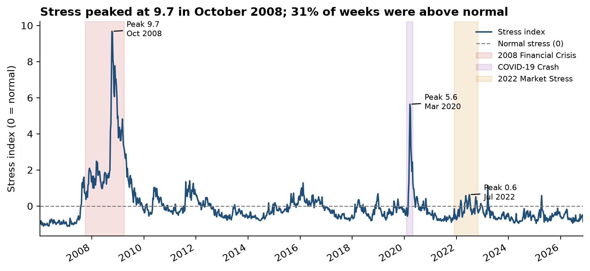

# Financial Stress Dashboard

An interactive Gradio dashboard exploring how financial crises affect markets.
Four panels, one per team member, each answering a different question about the
2008 Financial Crisis, the COVID-19 crash and the 2022 market stress.

## How to run

1. Install the packages:
   pip install -r requirements.txt
2. From the main folder, start the dashboard:
   python3 shared_app_gr.py
3. It opens in your browser at http://127.0.0.1:7860

No API key is needed: the FRED data is saved in the `Data` folder.
(Optional: to download fresh FRED data, set an environment variable `FRED_API_KEY`
and delete `Data/fred_STLFSI4.csv`.)

## Data

| Data | Source | File | Used by |
|---|---|---|---|
| Daily prices: SPY (US stocks), GLD (gold), TLT (US government bonds), USO (oil), from January 2007 | Yahoo Finance via yfinance (`download_data.py`) | `Data/market_data.csv` | Crisis Comparison |
| Expanded daily prices: SPY, QQQ, IWM, EFA, EEM, TLT, IEF, LQD, HYG, GLD, USO, VNQ | Yahoo Finance via yfinance | `Data/market_data_expanded.csv` | Crisis Correlation Heatmap |
| St. Louis Fed Financial Stress Index (STLFSI4, weekly, 0 = normal stress) | FRED API, downloaded once and saved by `load_stress()` | `Data/fred_STLFSI4.csv` | Crisis Comparison, Financial Stress Index |

## Crisis periods (shared by all panels)

| Crisis | Start | End |
|---|---|---|
| 2008 Financial Crisis | 2007-10-01 | 2009-03-31 |
| COVID-19 Crash | 2020-02-01 | 2020-04-30 |
| 2022 Market Stress | 2021-12-01 | 2022-10-31 |

Each window starts just before the US stock market peak and ends just after its low.

## Panels

### Dashboard Overview

The landing page presents four complementary visualisations
in a 2x2 grid, summarising equity market drawdowns,
cross-asset correlations, comparative crisis severity
and historical financial stress.

All charts are calculated dynamically from the existing
datasets. The four individual tabs provide more detailed
interactive analysis.

### 1. Equity Market Stress (Ruairi)
**Question** How were different equities markets affected during different crises?

For the selected date in each crisis, the following are calculated and plotted on either a line or bar chart:
- **Drawdown from Prrevious Peak**: the % fall of an index from the previous in-crisis peak
- **21 day annualized realized volatility**: compares historical volatility with priced-in forward-looking fear
- **Financial Sector ETF relative performance**: compares the FSETF's % change in relative performance to the S&P 500 from the start of the crisis
- **Volatility Index fear**: Pulls the VIX measure and classifies it based on severity

All calculations and plotting are done automatically when the date and/or crisis is changed

**Controls**
- **Select Crisis Period**: Choose which of the three crises to analyze
- **Inspect Date - Press Enter**: Manually enter the desired date and press enter to update the panel
- **+5/-5 Trading Days**: Skip forward/back 5 valid trading days. Panel automatically updates

**Analysis**
- **S&P 500 on YYYY-MM-DD**: Shows the S&P price, the crisis peak, highlights the drawdown, and displays the Financial Sector ETF's relative performance
- **Market Fear: VIX vs 21-Day Realised Volatility**: Shows the VIX value, its classifier, the 30-stress threshold, the 21-day realised volatility and the spread, the crisis peak so far and the number of days above the threshold
- **Drawdown from Crisis Peak (%)**: Shows the % drawdown from the previous in-crisis peak of the four indexes 

All calculations are completed using data from the following .csv files: `Data/fsetf.csv`, `Data/nasd.csv`, 
`Data/russ.csv`, `Data/sp.csv`, `Data/vix.csv`, no manual entry of figures

### 2. Crisis Comparison (Sean)
**Question:** Which financial crisis was most severe, and how did the crises differ?

For each asset in each crisis, the panel calculates from the raw daily prices:
- **Max drawdown**: the worst % fall from a peak
- **Peak yearly volatility**: the most turbulent point (rolling standard deviation of daily returns × √252)
- **Recovery time**: how long it took to get back to the old peak, or how long so far if it hasn't
- **Stress index peak**: the highest reading of the St. Louis Fed Financial Stress Index

No statistics are typed in manually, so adding a crisis to `CRISES` updates everything automatically.

**Controls**
- **Chart:** a bar chart comparing one measure, or a bubble chart showing all measures at once
- **Crises to include:** tick which crises to compare
- **Measure:** drawdown, volatility or recovery (bar chart only)
- **Volatility window:** 5 to 63 trading days (shown when volatility is on screen)

**Key findings**
- Oil fell about 80% in both 2008 and COVID, and has still not recovered from 2008.
- COVID falls were deep but short: most assets recovered within about a year.
- In 2022 the stress index barely rose above normal (0.63, against 9.68 in 2008),
  yet US government bonds fell 39% and have not recovered. Rising interest rates,
  not a system-wide panic.

**Checks:** `check_crisis_comparison.py` tests the functions on made-up prices
with known answers (run it with `python check_crisis_comparison.py`).

### 3. Crisis Correlation Heatmap (Eoin)

**Question:** How do relationships between major asset classes change during periods of financial stress?

The panel calculates daily log returns for 12 market ETFs covering equities, government and corporate bonds, gold, oil and real estate. It analyses how correlations differ across crises and how individual asset relationships evolve over time.

**Controls**
- **Crisis period:** choose between the 2008 Financial Crisis, COVID-19 Crash and 2022 Market Stress.
- **Analysis view:** switch between the crisis correlation matrix and the change in correlation relative to the normal-market benchmark.
- **Comparison asset:** select any of the other 11 ETFs to compare against SPY.
- **Rolling window:** adjust the slider between 5 and 60 trading days to explore short-term and longer-term correlations.

**Analysis**
- **Crisis correlation heatmap:** displays pairwise correlations between the 12 assets using a consistent -1 to +1 colour scale.
- **Normal-market benchmark:** excludes all three defined crisis periods and calculates correlations using the remaining observations.
- **Change vs Normal Market:** subtracts the benchmark matrix from the selected crisis matrix using a -2 to +2 colour scale.
- **Diversification ranking:** ranks seven potential diversifiers by their average correlation with the five selected equity ETFs.
- **Summary statistics:** reports average correlation, average absolute correlation and the highest and lowest pairwise correlations.
- **Correlation change statistics:** reports average change, average absolute change and the asset pairs experiencing the largest increases and decreases.
- **Rolling Correlation Explorer:** plots rolling correlations between SPY and a selected ETF throughout the crisis, alongside the normal-market benchmark.

**Implementation**
- Reusable functions separate data preparation, statistical analysis, visualisation and interface design.
- Vectorised NumPy operations calculate daily log returns.
- Missing and infinite returns are removed before analysis.
- The normal-market correlation matrix is cached to avoid repeated calculations.
- Portable file paths are implemented using pathlib.
- Gradio event handlers automatically update the analysis when users change their selections.

All statistics are calculated dynamically from `Data/market_data_expanded.csv`; no correlation results are manually entered.

### 4. Financial Stress Index (Dara)
**Question:** How stressed is the US financial system right now, and how do the three crises compare on one consistent measure?

The panel plots the St. Louis Fed Financial Stress Index (STLFSI4), a weekly index built from interest rates, yield spreads, and other market indicators. A value of 0 means normal stress; above 0 means more stress than normal. Each crisis period is shaded, and its peak is labelled automatically.

**Controls**
- **Start year / End year:** choose the period to show (1993 to 2026)
- **Crises to shade:** tick which crisis periods to highlight
- **Moving average:** smooth the line over 1 to 12 weeks (1 = raw weekly data), using the Simple Moving Average function

The chart title and the summary line under it (latest reading, peak in the period, and % of weeks above normal) are recalculated for whatever period is selected.

**Key Findings**
- Stress peaked at **9.7 in October 2008**, far higher than any other point since 1993.
- COVID was sharp but short: stress jumped to **5.6 in March 2020** and fell back within weeks.
- **2022 barely registered**, peaking at only **0.6 in July 2022**. Markets fell, but the financial system itself was not under stress.
- From 2006 to 2026, **31% of weeks** had above-normal stress.
- Smoothing has a cost: an 8 week average cuts the 2008 peak from 9.7 to 7.8 and moves the COVID peak from March to April 2020.

**Checks:** run 'python3 Panels/Financial_Stress_Index.py' to test the panel on its own. It prints the data and summary statistics, shows the chart, and saves it to 'figures/stress_index.png

## Use of AI tools

As permitted by the module lecturer, team members used AI assistants
(e.g. Claude, Copilot, Gemini, ChatGPT) to explain concepts, help find and fix errors,
and suggest code, which we then adapted, tested and checked against the data.
Each member's use of AI is described in their individual learning journal.

## Contributions

| Member | Panel | Files |
|---|---|---|
| Ruairi | Equity Market Stress | `Panels/Equity_Market_Stress.py` |
| Sean | Crisis Comparison | `Panels/Crisis_Comparison.py`, `check_crisis_comparison.py |
| Eoin | Crisis Correlation Heatmap | `Panels/Crisis_Correlation_Heatmap.py` |
| Dara | Financial Stress Index | `Panels/Financial_Stress_Index.py` |
| Shared | Dashboard app | `shared_app_gr.py` |